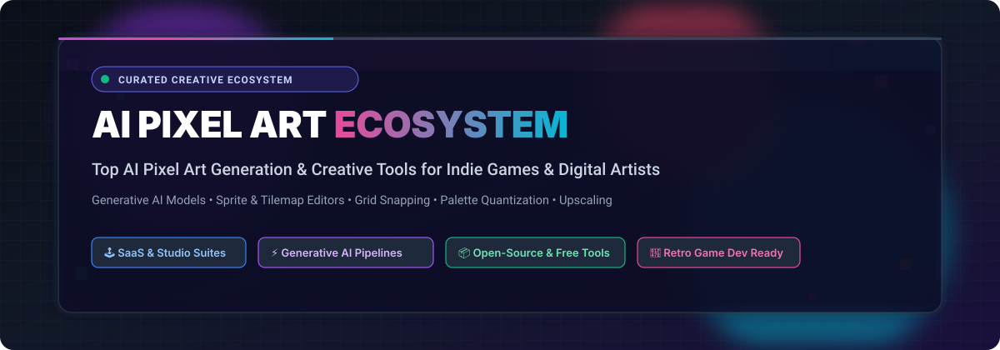

# 🎨 Awesome AI Pixel Art Generation & Creative Tools 👾

<div align="center">

<a href="./assets/banner.svg">
  
</a>

<br/><br/>

<a href="https://github.com/ishandutta2007/Awesome-Awesome-Awesome"></a><a href="https://discord.gg/jc4xtF58Ve"></a>
<a href="https://github.com/ishandutta2007/Awesome-AI-Pixel-Art-Generation-Creative-Tools/stargazers"></a>
<a href="https://github.com/ishandutta2007/Awesome-AI-Pixel-Art-Generation-Creative-Tools/network/members"></a>
<a href="https://github.com/ishandutta2007/Awesome-AI-Pixel-Art-Generation-Creative-Tools/blob/main/LICENSE"></a>
<a href="https://github.com/ishandutta2007/Awesome-AI-Pixel-Art-Generation-Creative-Tools/pulls"></a>
<a href="https://github.com/ishandutta2007"></a>

<p align="center">
  <strong>The definitive curated index of AI pixel-art generators, sprite &amp; tilemap editors, neural grid-restoration utilities, retro game pipelines, and palette quantization tools.</strong>
</p>

<p align="center">
  <sub>Updated November 2026 • Maintained by <a href="https://github.com/ishandutta2007">@ishandutta2007</a> and the open-source community</sub>
</p>

</div>

---

## 📌 Executive Summary & Quick Start

Welcome to **Awesome AI Pixel Art Generation & Creative Tools**! Whether you are an indie game developer looking for retro 8-bit / 16-bit sprites, a technical artist constructing procedural tilesets, or a researcher building diffusion-to-pixel downscalers, this catalog tracks the state of the art in pixel creation tooling.

### 🔍 Key Capabilities Highlighted:
- 🤖 **Agentic & Natural-Language Sprite Generation**: Automate retro asset workflows with coding agents (such as Claude Code skills like `crsolver/claude-pxl`).
- 🎨 **Diffusion & LoRA Pipelines**: Generate high-fidelity sprites using `ComfyUI` workflows coupled with `FLUX` / `SDXL` pixel LoRAs.
- 📐 **Neural Grid Snapping & Restoration**: Clean "faux pixel art" by snapping blurry diffusion outputs onto integer grids with `Proper-Pixel-Art` and `PixelDetector`.
- 🖌️ **Frame-by-Frame Sprite Editors**: Industry-standard editors like `Aseprite`, `Pixelorama`, `LibreSprite`, and `Piskel`.
- 🗺️ **Procedural Map & Level Generators**: Assemble tilesets seamlessly with `Tiled`, `WaveFunctionCollapse`, and `Godot Engine`.

---

## 📑 Table of Contents

- [📊 Sector Overview & Market Dynamics](#-sector-overview--market-dynamics)
- [☁️ SaaS & Hosted Commercial Platforms](#️-saas--hosted-commercial-platforms)
- [📦 Open-Source GitHub Projects](#-open-source-github-projects)
- [🛠️ Recommended Modular Pipeline Architecture](#️-recommended-modular-pipeline-architecture)
- [🤝 How to Contribute](#-how-to-contribute)
- [💖 Support & Sponsorship](#-support--sponsorship)
- [📈 Star History](#-star-history)
- [📄 License & Disclaimer](#-license--disclaimer)

---

## 📊 Sector Overview & Market Dynamics

The dedicated pixel art creative software market is estimated at approximately **$0.5B to $0.9B**, embedded inside the broader **$2.0B+** generative AI gaming tools and **$3.8B+** retro gaming market sectors. 

The sector exhibits **moderate fragmentation**:
- **Desktop & Native Dominance**: Standalone desktop suites—most notably **Aseprite** with an estimated $7.6M–$18M+ lifetime Steam gross revenue—remain the defensible creative choice for production pipelines and modders.
- **Web & Mobile Diversity**: Cloud and mobile touch environments remain fragmented across specialized solo-developer apps (Pixilart, Pixaki, Resprite, Dottable) and community palette databases (Lospec).
- **Generative AI Disruption**: New generation-first platforms (such as PixelLab / Retro Diffusion) and agentic developer skills are rapidly bridging text prompting with true grid-snapped asset delivery, creating agile micro-ecosystems across indie game studios.

---

## ☁️ SaaS & Hosted Commercial Platforms

Below is the comparative breakdown of commercial and hosted SaaS platforms, ordered descending by estimated company scale and revenue.

| Product / Company | Company Scale (Revenue / Valuation) | Pricing | Free Tier / Trial Limits | Key Features & Highlights |
| :--- | :--- | :--- | :--- | :--- |
| **[Aseprite](https://aseprite.org)** <br/><sub>*(Igara Studio S.A.)*</sub> | 🏆 ~$7.6M–$18M+ lifetime Steam revenue (~$5.3M+ net developer earnings; bootstrapped) | $19.99 *(one-time purchase on Steam / itch.io)* | Free trial with unlimited time; saving and exporting files is disabled | Industry-standard animated sprite editor and pixel-art tool with timeline animation, onion skinning, tilemaps, Lua scripting, and source-available compilation. |
| **[Pixilart](https://pixilart.com)** <br/><sub>*(Pixilart LLC)*</sub> | 📈 ~$1M–$5M estimated annual revenue *(bootstrapped)* | $4.99/mo *(Pixilart PRO)* | Free forever plan; includes core drawing and animation tools, capped at 50 custom stamps and supported by ads | Cloud-based collaborative pixel art drawing platform, frame-by-frame GIF animator, and vibrant social art community featuring browser-native layer tools. |
| **[Pixaki](https://rizer.co)** <br/><sub>*(Rizer Inc.)*</sub> | 🎨 ~$880K estimated annual revenue *(independent studio)* | $26.99 *(one-time purchase for Pixaki 4 Pro on iPadOS)* | Free forever tier *(Pixaki Intro)*; capped at 160×160 px canvas size, 3 drawing layers (+1 reference), and 8 animation frames | Dedicated iPad pixel-art and animation studio offering Procreate-grade touch/Apple Pencil workflows, onion skinning, and native `.ase` file export. |
| **[PixelLab / Retro Diffusion](https://pixellab.ai)** | ⚡ Bootstrapped indie AI platform *(~$100K–$300K ARR estimated; self-funded)* | $12.00/mo *(Pixel Apprentice tier; unlocks larger sizes & map tools)* | Free plan; grants 40 fast generations on signup, thereafter 5 daily generations (stored up to max 20), capped at 200×200 px resolution | Specialized cloud AI pixel-art studio built for game developers to generate 4/8-direction character walk cycles, isometric tilesets, and palette-locked assets. |
| **[Resprite](https://fengeon.com)** <br/><sub>*(Jiaxing Fengeon Software Co.)*</sub> | 📱 Bootstrapped indie software studio *(<$250K estimated annual revenue)* | $27.99 *(one-time lifetime purchase on iOS / Steam)* | Free forever version; full canvas access but limits the number of daily export attempts and locks advanced symmetry/color adjustment tools | Modern cross-platform sprite editor and pixel-art studio for iPad, iPhone, and desktop featuring animation timelines, tilemap editing, and cloud project sync. |
| **[PixelMe](https://pixel-me.tokyo)** | 🖼️ Bootstrapped solo-developer project *(<$100K estimated annual revenue)* | $4.99/week or $29.99/year *(Pro mobile plan)* | Free forever web plan; basic photo-to-pixel-art conversions at standard resolutions with basic watermarking/ad support | Web and mobile AI pixel-art portrait generator transforming photographs and illustrations into stylized, palette-quantized 8-bit avatars. |
| **[Pyxel Edit](https://pyxeledit.com)** | 🧱 Bootstrapped solo-developer project *(<$100K estimated annual revenue)* | $9.00 *(one-time purchase beta license)* | Free legacy version only *(v0.2.x, unmaintained/severely feature-limited)*; no modern free trial for current versions | Specialized pixel-art and level-design editor built around linked tile instances, tileset auto-generation, and frame-by-frame sprite animation. |
| **[Dottable](https://dottable.app)** <br/><sub>*(Yosuke Seki)*</sub> | 📲 Bootstrapped solo-developer project *(<$50K estimated annual revenue)* | $2.99 *(one-time in-app purchase to remove ads)* | Free forever plan; full core sprite and GIF editing features, ad-supported with standard project slot caps | Mobile and tablet pixel-art creation studio focused on clean indexed palettes, symmetrical drawing tools, and quick sprite animation exports. |
| **[Lospec](https://lospec.com)** | 🌐 Community-funded open platform *(~$6K–$12K/year via Patreon; ~$500/mo)* | $1.00/mo *(Patreon Supporter tier)* | Free forever platform; unlimited access to browser pixel editor, tutorials, and color palette database without paywalls | Premier web hub for pixel artists offering a browser-based Lospec Pixel Editor, thousands of curated retro color palettes, and pixel-art tutorials. |

---

## 📦 Open-Source GitHub Projects

Below are the premier open-source repositories and creative libraries for pixel art generation, neural restoration, sprite editing, and game pipelines. 

Repositories are **sorted strictly in descending order by GitHub Stars** and feature live social badges linking to their respective stargazers pages:

1. **[ComfyUI](https://github.com/comfyanonymous/ComfyUI)** <a href="https://github.com/comfyanonymous/ComfyUI/stargazers"></a>  
   *Most powerful modular node-based diffusion engine widely used with `FLUX` / `SDXL` pixel-art LoRAs, nearest-neighbor downscalers, and palette-clamping nodes.*

2. **[Godot Engine](https://github.com/godotengine/godot)** <a href="https://github.com/godotengine/godot/stargazers"></a>  
   *Leading open-source (`MIT`) 2D/3D game engine featuring integer pixel-snap rendering, animated sprite sheets, and `TileMapLayer` auto-tiling workflows.*

3. **[Aseprite](https://github.com/aseprite/aseprite)** <a href="https://github.com/aseprite/aseprite/stargazers"></a>  
   *Industry-standard animated sprite editor and pixel-art tool with source code available under EULA, allowing developers to compile custom builds and automate workflows via CLI and Lua scripts.*

4. **[WaveFunctionCollapse](https://github.com/mxgmn/WaveFunctionCollapse)** <a href="https://github.com/mxgmn/WaveFunctionCollapse/stargazers"></a>  
   *Bitmap and tilemap generation algorithm that creates infinite procedural pixel-art patterns, rooms, and terrains consistent with sample pixel tilesets.*

5. **[Pyxel](https://github.com/kitao/pyxel)** <a href="https://github.com/kitao/pyxel/stargazers"></a>  
   *Retro game development engine for Python inspired by classic consoles; includes built-in pixel image/sprite editors, tilemap generators, and audio sound effect synthesis.*

6. **[ImageMagick](https://github.com/ImageMagick/ImageMagick)** <a href="https://github.com/ImageMagick/ImageMagick/stargazers"></a>  
   *Essential CLI toolkit for batch nearest-neighbor pixel resizing (`-filter point`), color reduction, dithering algorithms, and automated sprite sheet montage generation.*

7. **[Pillow](https://github.com/python-pillow/Pillow)** <a href="https://github.com/python-pillow/Pillow/stargazers"></a>  
   *The friendly Python imaging library powering automated median-cut palette quantization, transparent sprite slicing, and retro color dithering scripts.*

8. **[Tiled](https://github.com/mapeditor/tiled)** <a href="https://github.com/mapeditor/tiled/stargazers"></a>  
   *Versatile, flexible open-source (`GPL-2.0`) 2D tilemap editor supporting orthogonal, isometric, and hexagonal maps with direct engine export (Godot, Unity, Defold).*

9. **[Piskel](https://github.com/piskelapp/piskel)** <a href="https://github.com/piskelapp/piskel/stargazers"></a>  
   *Free and open-source (`Apache-2.0`) browser-based and desktop sprite editor featuring live animated previews, onion skinning, and animated GIF / sprite-sheet export.*

10. **[Pixelorama](https://github.com/Orama-Interactive/Pixelorama)** <a href="https://github.com/Orama-Interactive/Pixelorama/stargazers"></a>  
    *Modern, cross-platform open-source (`MIT`) 2D sprite editor and animator created with Godot Engine; features custom pixel brushes, palette swatches, and timeline animation.*

11. **[Krita AI Diffusion](https://github.com/Acly/krita-ai-diffusion)** <a href="https://github.com/Acly/krita-ai-diffusion/stargazers"></a>  
    *Streamlined inpainting and generative AI plugin for Krita with real-time ComfyUI integration, allowing artists to prompt and refine pixel-art sprites directly on canvas.*

12. **[Krita](https://github.com/KDE/krita)** <a href="https://github.com/KDE/krita/stargazers"></a>  
    *Professional open-source digital painting application featuring pixel-art brush presets, wrap-around tile mode, animation curves, and layer blend modes.*

13. **[LibreSprite](https://github.com/LibreSprite/LibreSprite)** <a href="https://github.com/LibreSprite/LibreSprite/stargazers"></a>  
    *Completely free and open-source (`GPL-2.0`) fork of Aseprite; offers native sprite animation, layers, onion skinning, and indexed color palettes.*

14. **[GIMP](https://github.com/GNOME/gimp)** <a href="https://github.com/GNOME/gimp/stargazers"></a>  
    *Full-featured raster graphics editor featuring indexed-color palette conversion, nearest-neighbor scaling, pixel-level pencil tools, and batch Python scripting.*

15. **[Blockbench](https://github.com/JannisX11/blockbench)** <a href="https://github.com/JannisX11/blockbench/stargazers"></a>  
    *Modern 3D low-poly modeler and pixel-art UV texture painter with integrated animation tools, widely utilized for retro game assets and voxel art.*

16. **[TIC-80](https://github.com/nesbox/TIC-80)** <a href="https://github.com/nesbox/TIC-80/stargazers"></a>  
    *Open-source fantasy computer featuring built-in 16-color pixel art tools, sprite and map editors, sound synthesis, and code editors for retro game creation.*

17. **[Free Texture Packer](https://github.com/odrick/free-tex-packer)** <a href="https://github.com/odrick/free-tex-packer/stargazers"></a>  
    *Cross-platform desktop and web utility that packs individual pixel-art sprites into compact texture atlases with JSON, XML, and game-engine exports.*

18. **[libretro Common Shaders](https://github.com/libretro/common-shaders)** <a href="https://github.com/libretro/common-shaders/stargazers"></a>  
    *Collection of real-time post-processing shaders including high-performance pixel-art magnification algorithms (`xBRZ`, `HQx`, `ScaleFX`, `2xSaI`) and CRT scanlines.*

19. **[claude-pxl (`crsolver/claude-pxl`)](https://github.com/crsolver/claude-pxl)** <a href="https://github.com/crsolver/claude-pxl/stargazers"></a>  
    *AI coding-agent pixel-art generation skill for Claude Code that enables prompt-driven sprite generation, iterative asset refinement, and direct game asset export.*

20. **[Proper-Pixel-Art](https://github.com/KennethJAllen/proper-pixel-art)** <a href="https://github.com/KennethJAllen/proper-pixel-art/stargazers"></a>  
    *Open-source computer vision algorithm and utility that detects grid dimensions and restores blurry, misaligned AI-generated pixel art back onto crisp integer grids.*

21. **[Pixelization](https://github.com/WuZongWei6/Pixelization)** <a href="https://github.com/WuZongWei6/Pixelization/stargazers"></a>  
    *Deep-learning framework for image-to-pixel-art style transfer designed to preserve sharp contours, structural outlines, and distinctive retro color palettes.*

22. **[PixelDetector](https://github.com/Astropulse/pixeldetector)** <a href="https://github.com/Astropulse/pixeldetector/stargazers"></a>  
    *Algorithmic and neural grid detection utility by Astropulse (creator of Retro Diffusion) that automatically downscales diffusion outputs to native 1x1 pixel resolutions.*

23. **[claude-pxl (`augusto-scarvalho/claude-pxl`)](https://github.com/augusto-scarvalho/claude-pxl)** <a href="https://github.com/augusto-scarvalho/claude-pxl/stargazers"></a>  
    *Specialized Claude Code skill toolkit enabling prompt-driven generation of retro sprites, character icons, and structured pixel-grid art within coding assistant workflows.*

---

## 🛠️ Recommended Modular Pipeline Architecture

To build a zero-cost or hybrid production-grade pixel art game asset pipeline:

```
┌─────────────────────────────────┐
│     1. Generative AI Phase      │ ──> ComfyUI (Pixel LoRAs) / crsolver/claude-pxl
└────────────────┬────────────────┘
                 │
                 ▼
┌─────────────────────────────────┐
│    2. Neural Snapping Phase     │ ──> Proper-Pixel-Art / Astropulse PixelDetector
└────────────────┬────────────────┘
                 │
                 ▼
┌─────────────────────────────────┐
│     3. Manual Sprite Polishing  │ ──> Aseprite / Pixelorama / LibreSprite
└────────────────┬────────────────┘
                 │
                 ▼
┌─────────────────────────────────┐
│    4. Sprite Sheet Packing      │ ──> Free Texture Packer / ImageMagick CLI
└────────────────┬────────────────┘
                 │
                 ▼
┌─────────────────────────────────┐
│     5. Game Engine Integration  │ ──> Godot Engine / Tiled Level Editor
└─────────────────────────────────┘
```

---

## 🤝 How to Contribute

Contributions from developers, artists, and tool authors are very welcome!

1. 🍴 **Fork the repository** on GitHub.
2. 🌿 **Create a new branch**: `git checkout -b feature/add-new-tool`.
3. ✏️ **Add your entry** to either the SaaS table or the Open-Source catalog:
   - Provide the project name, clean markdown URL, and GitHub badge if applicable.
   - For SaaS products, include entry-level pricing and exact free tier/trial limits.
   - Keep descriptions concise, factual, and neutral.
4. 🚀 **Commit and push** your changes: `git push origin feature/add-new-tool`.
5. 📬 **Submit a Pull Request** with a brief summary of the project.

---

## 💖 Support & Sponsorship

If this curated list saved you time, enhanced your retro game development pipeline, or introduced you to your new favorite pixel-art tool, please consider showing your support:

- ⭐ **Star this repository** to help other creators discover it!
- 🍴 **Fork and share** with fellow indie developers, artists, and game dev communities.
- ☕ **Sponsor the Maintainer**: Support ongoing curation, tooling experiments, and open-source maintenance via the [GitHub Sponsor Dashboard](https://github.com/sponsors/ishandutta2007).

Thank you for being part of the creative tooling community! 🙌

---

## 📈 Star History

[](https://www.star-history.com/#ishandutta2007/Awesome-AI-Pixel-Art-Generation-Creative-Tools&type=date&legend=top-left)

---

## 📄 License & Disclaimer

- **License**: Released under the [MIT License](file:///C:/Users/ishan/Documents/Projects/Awesome-AI-Pixel-Art-Generation-Creative-Tools/LICENSE).
- **Disclaimer**: This repository is a community-curated research catalog. All product names, logos, and brands are property of their respective owners. Mention does not imply endorsement.
